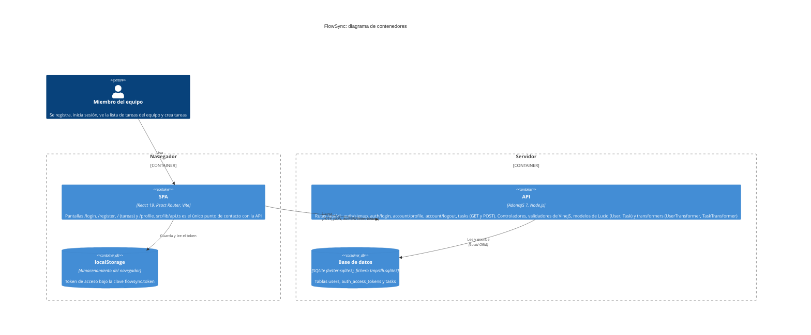

# Arquitectura

Diagrama de contenedores (nivel 2 de C4) de FlowSync, sacado del código. Una persona del equipo usa una SPA de React que corre en su navegador. La SPA guarda el token de sesión en `localStorage` y habla con la API de AdonisJS por HTTP con JSON, enviando ese token como `Bearer`. La API valida cada petición con VineJS, lee y escribe con Lucid en un fichero SQLite, y devuelve las respuestas envueltas en `{ data }` a través de los transformers.

Notas:

- **Autenticación:** el guard por defecto es `api`, con tokens de acceso opacos que se guardan en `auth_access_tokens`. El guard de sesión (`web`) está configurado pero ninguna ruta lo usa, así que no aparece en el diagrama.
- **Rutas protegidas:** las de `account` y `tasks` llevan el middleware `auth`. Las de `auth` (registro e inicio de sesión) son públicas.
- **Base de datos de los E2E:** los E2E usan otro fichero, `tmp/e2e.sqlite3` (variable `DB_FILE`). Es la misma base de datos con otro fichero, no otro contenedor.
